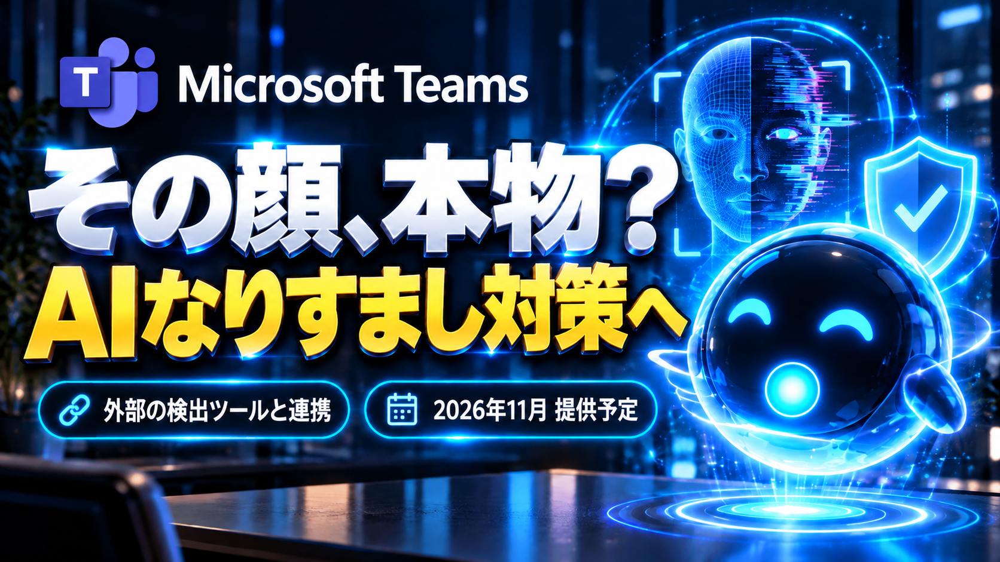
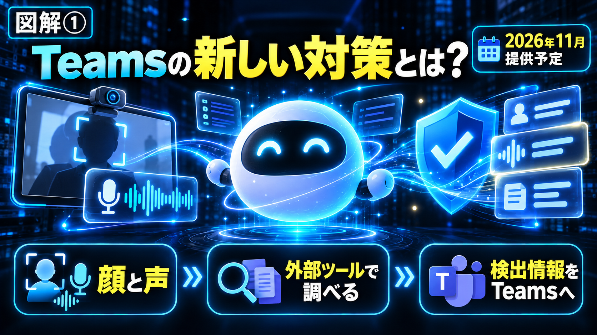
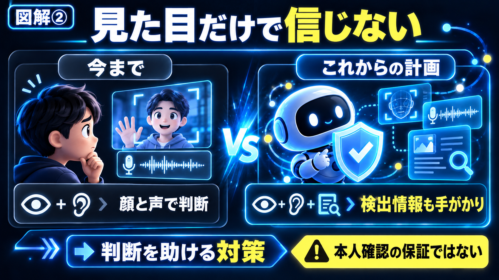
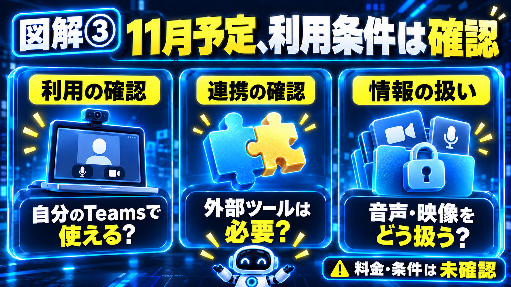
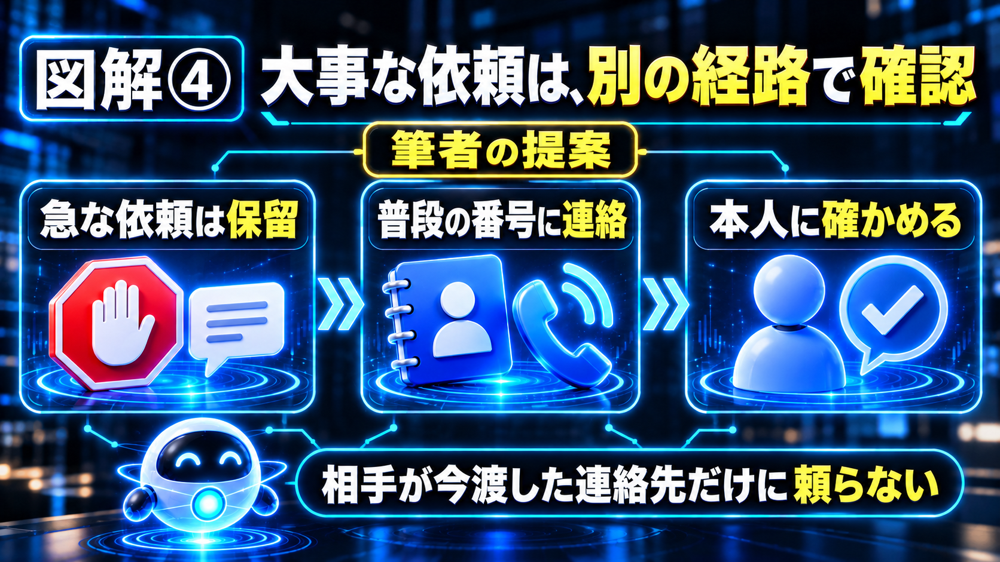

# 【海外AI解説】Microsoft Teamsが「第三者製ディープフェイク検出」を受け入れへ――会議でのなりすまし対策、11月提供見込み

会議で“上司や取引先の顔・声”がAI合成で突然現れ、指示や金銭要求を行う――そんな悪用リスクに対して、MicrosoftはTeamsに第三者製のディープフェイク検出ソリューションを組み込める仕組みをロードマップで示しました（Message Center ロードマップID: RM573451）。報道によれば、対象はデスクトップ・Mac・Webで、企業向けに2026年11月の一般提供が目標とされています。

## 30秒で結論

- MicrosoftはTeams会議で“第三者の合成音声・映像検出”をプラグイン形式で受け入れる予定。
- 機能は管理者が導入でき、デスクトップ・Mac・Webで動作。一般提供は2026年11月が目標（ロードマップ記載）。
- 検出はあくまで“補助”であり、誤検出や未検出のリスクが残るため運用ルールとユーザー教育が必要。
- 第三者ベンダーとの連携により、検出精度や応答速度、プライバシー設計が製品ごとに違う点に注意。

## ディープフェイク検出って何ができるの？

ディープフェイク検出とは、映像や音声が合成（AI生成）された兆候を自動で見つける技術です。具体的には、映像の顔合成で不自然なまばたきや皮膚の反射、音声では周波数や発話タイミングの不整合、あるいは生成モデル特有の信号を検出する方法が使われます。今回の発表は、Teams自体が検出アルゴリズムを提供するのではなく、認定された第三者プロバイダーの検出エンジンを“プラグイン”の形で組み込み、会議中に自動で解析（あるいは管理者が許可した場合にのみ解析）して“疑わしい合成”をフラグ化するというものです。検出結果は会議の主催者や管理者に通知され、ユーザーが会議からの退出や追加の認証を要求するなどの対応を取れる設計が想定されています（ここに図解①を挿入｜短いテーマ）。

【ここに図解①を挿入｜検出の全体像】

## なりすまし保護（Impersonation protection）の仕組みは？

発表資料や報道が合わせて示す“なりすまし保護”は、単なる合成検出だけでなく、会議参加者の振る舞いやアカウントのメタ情報を組み合わせて“誰かになりすましている可能性”を判断する機能を指します。例えば外部ドメインから突然参加した“上司の名義”のアカウント、短時間での表示名変更、会議招待の送信元不一致、あるいは合成検出結果と併せて高リスクと判定した場合に、Teamsが警告バナーを表示したり、管理者にレポートを上げる、といった動作が考えられます。これは“技術検出＋組織ルール”を組み合わせた防御で、運用ポリシー（誰が警告を受け取るか／どのアクションを自動化するか）を企業側で決める必要があります（ここに図解②を挿入｜比較）。

【ここに図解②を挿入｜検出 vs なりすまし保護】

## 現実的な制約とリスクは何か？

検出技術は進んでいるものの完全ではありません。誤検出（合法的な画面共有や映像加工を合成と誤判定）や偽陰性（巧妙な合成を見逃す）といった問題が残ります。また、第三者プロバイダーを組み込むことで、音声・映像データの処理経路や一時保存、ログの取り扱いが増え、プライバシーやコンプライアンス上の課題が生じます。加えて、検出にかかるレイテンシ（リアルタイム性）やコスト、管理者の運用負荷も考慮点です。技術は“補助”なので、最終的にはユーザーの確認フローや社内の認証プロセスを整えることが重要です（ここに図解③を挿入｜仕組み）。

【ここに図解③を挿入｜現実的な制約】

## 企業は具体的に何を準備すべきか？

まずは管理者レベルでTeamsの新機能が自社のテナントにいつ展開されるかを確認し、ポリシーを検討します。検出ベンダーの選定基準としては検出精度（第三者評価やベンチマーク）、プライバシー方針（会議データの保管・削除方針）、レイテンシ、料金体系、サポート体制を比較します。運用面では、誤検出に備えたエスカレーションルール（誰に通知するか、どのアクションを自動化するか）と、参加者向けの教育（会議の本人確認手順や警告への対応）を整備することが推奨されます。導入初期は限定的なチームでトライアルする“段階的展開”が実務上は現実的です（ここに図解④を挿入｜読者の判断）。

【ここに図解④を挿入｜導入チェックリスト】

## 私の正直な感想

正直な感想を率直に言うと、“技術の導入自体は前向き”ですが、実務で真に効くようにするには運用の工夫が欠かせません。例えば、営業や顧客対応チームが外部相手と会う場面では、検出で警告が出たときに“すぐ通話を切る”だけでなく、代替認証（社内の確認用ワンタイムコードや別チャネルでの確認）を即座に実行できる体制が必要です。例えば、重要な発注や金銭に関わる指示を受けた際に、必ず“別の手段での確認”を義務化する、といった運用ルールが考えられます。ただし中小企業だと導入コストや管理工数が負担になるので、まずはハイリスク業務に限定して試すのが実際的です。

## よくある質問

### Q1: この機能は個人向けのTeamsでも使えますか？

A1: 公表されている情報では企業向けのテナント管理機能としての提供が中心で、管理者が第三者検出ツールを有効にする運用を想定しています。個人向け（無料版）での即時提供は明示されていません。

### Q2: 検出したデータはどこに送られますか？

A2: 詳細はベンダーとMicrosoftの実装次第です。第三者の検出エンジンに映像や音声のメタデータや解析用ストリームが送られる可能性があり、プライバシー契約やデータ保持ポリシーを事前に確認する必要があります。

### Q3: 誤検出で会議が中断されたらどうする？

A3: 誤検出に備えたエスカレーション手順（まず管理者へ通知、ヒューマンレビューを経て自動解除、など）を定めることが重要です。運用で誤検出の影響を小さくする設計が必要です。

### Q4: どのベンダーと連携するのですか？

A4: Microsoftのロードマップ発表には“認定された第三者プロバイダー”という表現はあるものの、具体的な社名は示されていません。今後の発表や認定一覧を確認してください。

## まとめ

今回の発表は、“技術で完全に安心を作る”ものではなく、合成メディアの悪用リスクに対する“有力な補助ツール”を企業に提供する一歩です。Teamsでの第三者検出プラグインにより、組織は会議のなりすましリスクをより早く把握できる可能性がありますが、誤検出・未検出・プライバシーの懸念・運用負荷といった現実的な課題を無視できません。導入を検討する際は、検出技術の評価、プライバシー契約、そして具体的な運用フローを先に固めることをおすすめします。

## この記事について

確認日：2026年10月11日（日本時間）。公式発表や報道で確認できた内容と、筆者の意見を分けて記載しています。公開後に情報が更新される場合があります。

## 参考リンク

- [Microsoft 365 Message Center - RM573451: Third-party synthetic audio and video detection in Microsoft Teams](https://mc.merill.net/message/RM573451)
- [Microsoft Teams will soon be able to spot third-party deepfakes on your morning meeting (TechRadar)](https://www.techradar.com/pro/microsoft-teams-will-soon-be-able-to-spot-third-party-deepfakes-on-your-morning-meeting)
- [Microsoft Teams to get support for third-party deepfake detection (BleepingComputer)](https://www.bleepingcomputer.com/news/security/microsoft-teams-to-add-third-party-deepfake-detection-impersonation-protection/)
- [Microsoft Teams will let companies plug in outside tools that flag deepfakes in meetings (Morning Overview)](https://morningoverview.com/microsoft-teams-will-let-companies-plug-in-outside-tools-that-flag-deepfakes-in-meetings/)

\#Microsoft #Teams #ディープフェイク #セキュリティ #AI検出 #インパーソネーション対策 #企業IT #プライバシー #サイバーセキュリティ #AI運用
