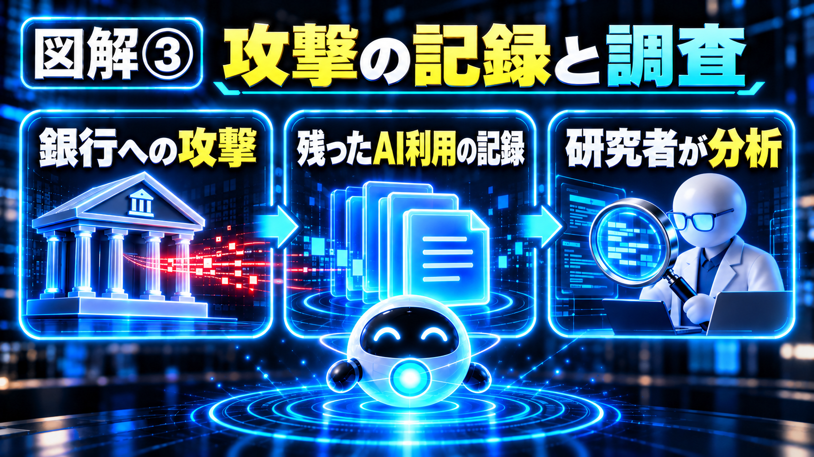

# 【海外AI解説】韓国の銀行攻撃でARTEXとClaude Codeの履歴を発見――履歴書から人物像、犯人は未確定

「AIを使った銀行への攻撃」と聞くと、すごく遠い世界の話に感じるかもしれません。

でも今回、調査の手がかりになったのは、AIツールの設定や作業履歴でした。さらに、その中には**Claude Codeに履歴書づくりを頼んだ会話**まで残っていたそうです。

セキュリティ企業CrowdStrikeの分析と10月10日の報道をもとに、韓国の銀行を狙った攻撃を整理します。まず押さえたいのは、**人物像の手がかりが出ても、犯人が特定されたわけではない**という点です。

---

## 30秒で結論

- ARTEXのような「AIに複数の作業を任せるツール」が実運用で悪用され、複数の銀行でデータ流出や一部システム停止が発生した。
- 攻撃に使われたとみられるARTEXの設定や、Claude CodeなどのAI利用履歴が見つかった。
- ARTEX開発者は攻撃公表後にプロジェクトをクローズド化したが、既存のフォークや派生物が残り続ける点がリスクを残す。
- 履歴書づくりの会話から人物像も浮かんだ。ただし、CrowdStrikeはその情報と攻撃者を確実には結び付けられないとしている。

---

## そもそもARTEXって何ができるの？

ARTEXは、システムに弱いところがないか調べる「セキュリティ診断」のために作られたAIツールです。

人が一つずつ指示するだけでなく、AIに次の作業を考えさせ、いくつかの作業を順に進める仕組みを持っています。こうした仕組みを「AIエージェント」と呼びます。

診断の道具として役立つ一方、使う人や目的が変われば、攻撃にも使われてしまう。その問題が表に出たのが今回の件です。

CrowdStrikeによると、研究者は**攻撃者側のサーバーで公開されていたフォルダ**からARTEXの設定やClaude Codeの履歴を見つけました。銀行側がそのフォルダを公開していた、という意味ではありません。

【ここに図解①を挿入｜ARTEXの仕組み】

---

## ClaudeなどのAIは、何をしていたの？

報告には、DeepSeekを中心に、GLMやGrokといったAIモデルの利用も登場します。Claude Codeの会話や作業履歴も、別の手がかりになりました。

図解に出てくる「LLM」は、文章を読んだり、指示に答えたりするAIの仕組みのことです。ChatGPTやClaudeを使うとき、その土台になっています。

イメージとしては、作業の指示を考える、情報を読む、次に何をするか考える、といった役割です。ただし、図解は役割を理解するための整理で、各モデルが全く同じ作業を担当したという意味ではありません。

**AIを使った痕跡が、逆に調査の手がかりにもなる。** 今回はそこが印象に残ります。「AIが使われた」という一言だけで、すべてのAIや利用者を危険と判断するのは早いと思います。

【ここに図解②を挿入｜LLMの役割】

---

## 実際に何が流出し、被害はどれほどか？

BleepingComputerは、新韓銀行、KB国民銀行、ハナ銀行などが標的になったと報じています。個人情報やカード情報の流出、一部システムの停止にも触れています。

ただし、**正確な被害件数や、影響を受けた組織の総数は未確定**です。ニュースの見出しに数字が出ていても、それを確定した被害件数として広げないよう注意したいところです。

CrowdStrikeが分析したのは、2026年9月下旬から10月上旬にかけての活動です。10月10日に出た報道を読んで整理していますが、攻撃自体がその日に始まったわけではありません。

### 履歴書に書かれた人物が、犯人なの？

ここは、決めつけないことが大切です。

研究者はClaude Codeの作業履歴から、履歴書の作成を頼んだ会話も見つけたと説明しています。その会話には、個人情報や連絡先など、人物像につながる情報が含まれていたそうです。

ただ、CrowdStrikeは、**その個人情報と攻撃者を、現時点で確実に結び付けることはできない**としています。

「人物像の手がかりが出た」ことと、「犯人が特定された」ことは別です。誰かの情報を借りて入力した可能性など、公開された資料だけでは確かめられない点があります。

自分は、AIを使った作業の履歴が、こういう調査の手がかりにもなるのかと驚きました。一方で、履歴に名前が出たからといって、その人を犯人扱いしてはいけないとも感じます。

【ここに図解③を挿入｜攻撃の記録と調査】

---

## 組織として何をすれば被害を減らせるか？

ここからは、今回の報告を読んだうえでの**筆者の提案**です。各銀行がすでに導入している対策を紹介するものではありません。

- **作業記録を残す：** 何が起きたのか、あとから確かめられるようにする。
- **使える権限を絞る：** AIに任せる場合も、仕事に必要な範囲だけ許可する。
- **環境を分ける：** 試す場所と大事な情報がある場所を分ける。
- **安全性を点検：** 設定や公開範囲に問題がないか、専門家も交えて確かめる。

初心者がこのニュースを読んで、銀行のシステムを自分で点検する必要はありません。仕事でAIを使うときなら、「このAIに何を見せて、何を任せているか」を確認するところから考えられます。

【ここに図解④を挿入｜防御のチェックリスト】

---

## 私の正直な感想

自分は、銀行への攻撃という大きな話の中に、「AIに履歴書を書いてもらう」という身近な使い方が出てきたことに驚きました。

書類づくりを頼むとき、何を入力して、どんな記録が残るか。そうした普段の使い方まで考えさせられるニュースです。

一方で、履歴に個人情報があったからといって、その人物を犯人と決めつけるのも怖いと感じます。**便利さを知ることと、分からない点を分からないままにしておくこと。** 両方が必要だと思いました。

---

## よくある質問

### ARTEXは違法ツールですか？

ARTEX自体は侵入テスト向けツールとして作られた経緯があり、ツール自体の存在が即違法とは限りません。ただし不正アクセス目的で使えば当然違法です。今回のような悪用例が出たため、倫理的・法的リスクが強調されています。

### 企業がAIエージェントを業務で使うのは危険ですか？

危険性はありますが、適切な利用ルール（誰が何を許可するか、ログを取る、外部アクセスを制限する）と監査を組めば有益性も高いです。今回の教訓は“権限と可視化”を最初に作ることです。

### 個人として被害を避ける方法はありますか？

個人は多くを直接制御できませんが、銀行など重要サービスの不審通知に注意する、二段階認証を有効化する、カード明細を定期的に確認することが実務的な防御になります。

---

## まとめ

今回のニュースでは、韓国の銀行を狙った攻撃に、ARTEXや複数のAIの利用履歴が結び付いています。調査を進める手がかりには、履歴書づくりの会話もありました。

ただし、被害の全体像も犯人の特定も、まだ確定していません。**何が確認され、何が未確認なのか**を分けて読むことが大切です。

AIを便利に使うときも、任せる範囲や残る記録を考える。このニュースから持ち帰れるのは、そんな基本的な確認だと思います。

---

## この記事について

確認日：2026年10月11日（日本時間）。公式発表や報道で確認できた内容と、筆者の意見を分けて記載しています。公開後に情報が更新される場合があります。

---

## 参考リンク

- [Unknown Threat Actor Uses AI-Driven ARTEX to Target South Korean Finance](https://www.crowdstrike.com/en-us/blog/unknown-threat-actor-uses-artex-to-target-south-korean-finance/)
- [Hacker used ARTEX AI and Claude agents to target South Korean banks](https://www.bleepingcomputer.com/news/security/hacker-used-artex-ai-and-claude-agents-to-target-south-korean-banks/)

\#AI #AIニュース #Claude #ClaudeCode #ARTEX #AIエージェント #サイバー攻撃 #セキュリティ #韓国 #銀行 #個人情報 #生成AI
