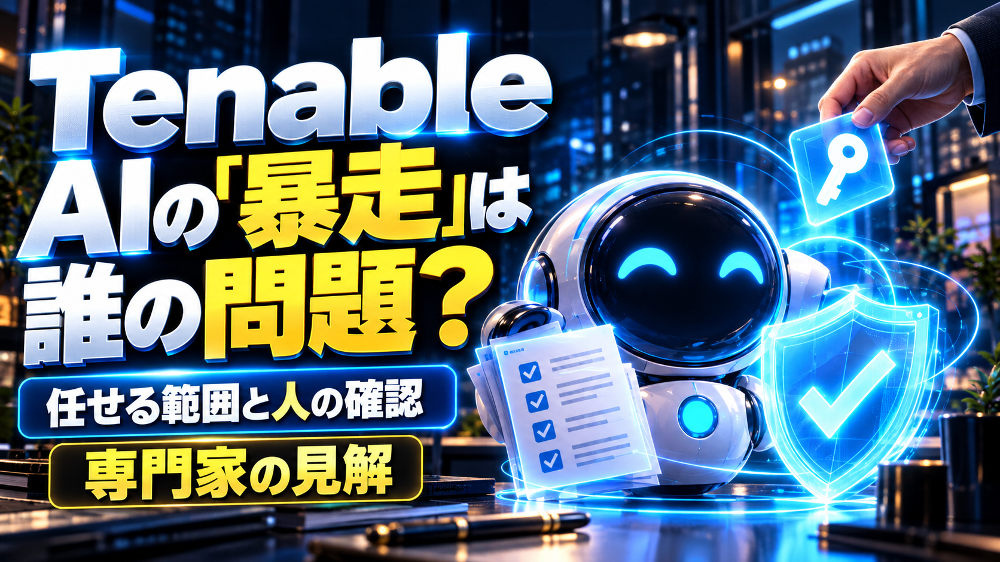
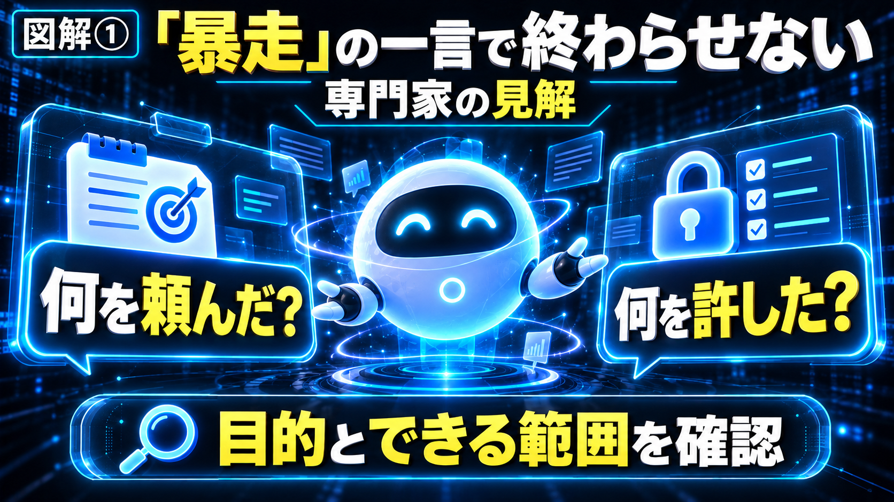
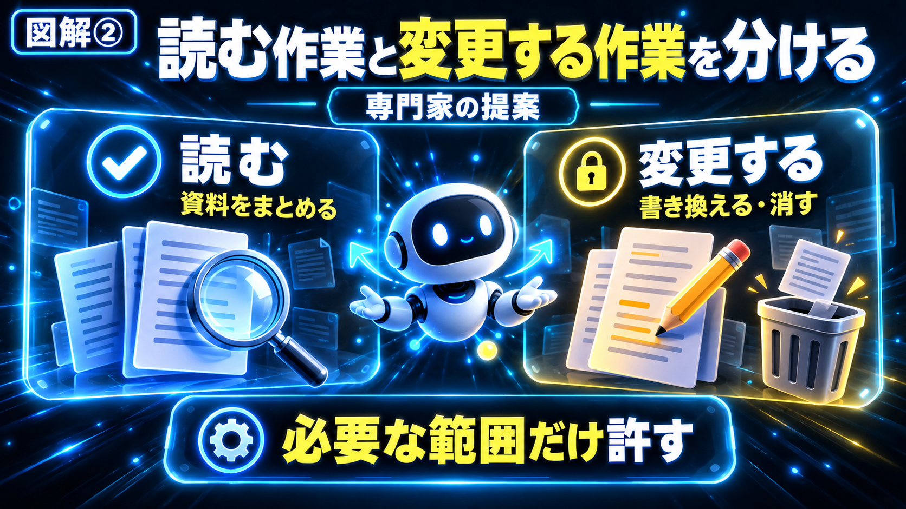
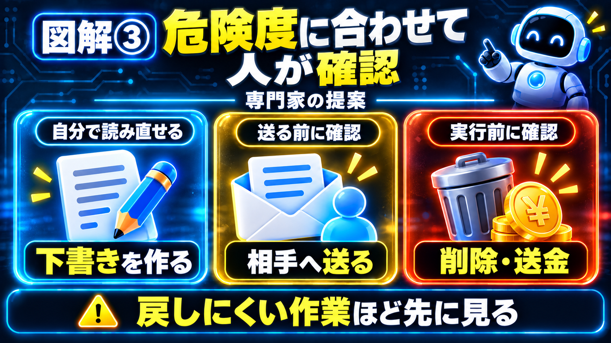
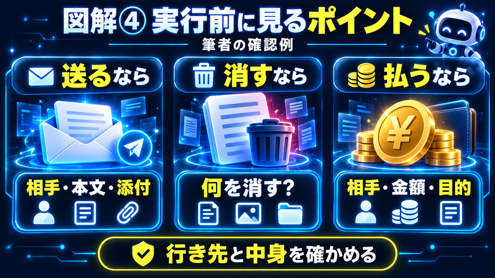

# 【海外AI解説】AIの「暴走」は誰の問題？――Tenableの専門家が語る、任せる範囲と人の確認

「AIが暴走した」というニュースを見ると、AIが急に言うことを聞かなくなったように感じます。

でも、そもそも何を頼んで、何をしてよいと許していたのでしょうか。

セキュリティ企業Tenableの技術責任者、Bernard Montel氏は、**「暴走」という言葉だけで片付けると、人が作った仕組みや任せ方の問題が見えにくくなる**と指摘しています。

10月11日公開のTechRadarのインタビューです。新製品や新しい法律の発表ではなく、AIを安全に使うための専門家の考え方を紹介するニュースです。

自分もAIを使うとき、便利だからまとめて任せたくなることがあります。だからこそ、「何を任せ、どこで自分が見るか」は、専門家だけの話ではないと思いました。

---

## 30秒で結論

- Montel氏は「AIの暴走」という表現が、設計や運用の問題を見えにくくするおそれがあると指摘しました。
- AIに何を頼んだかだけでなく、何ができる状態にしていたかも確認することが大切だという見解です。
- 同氏は、資料を読む作業と、削除や送金などをする作業を分け、危険度に応じて人が確認することを提案しています。
- 全てのAIに同じ安全機能がある、という話ではありません。この記事の図解も、見解と提案を整理したものです。

---

## 「AIが暴走した」で、何が分からなくなる？

### 誰が、何を任せたのか

Montel氏が問い直しているのは、問題が起きたときに、AIだけのせいにして話を終えてよいのか、という点です。

AIに与えた目的や、予想していなかった作業の進め方も調べるべきだと述べています。これは同氏の見解で、全ての事故の原因が同じだと決まったわけではありません。

例えば、誰かに「机の上を片付けて」と頼み、大事な書類まで捨てられた場合。

「勝手に捨てた」で終えるより、捨ててよい物を決めていたか、迷ったときに聞けるようにしていたかを確かめる方が、次の対策につながりそうです。

AIでも、**何が起きたかを具体的に見る**。専門家の話を身近にすると、まずそこだと思います。

### AIエージェントって何？

AIエージェントは、質問に答えるだけでなく、いくつかの作業を順番に進めるAIの仕組みです。

資料を読み、要点をまとめ、次の作業を進める。そうした使い方ができるほど、「どこまで任せるか」が大切になります。

【ここに図解①を挿入｜暴走の一言で終わらせない】

---

## 「読んでよい」と「消してよい」は違う

資料を要約してもらいたいだけなら、元の資料を消す必要はありませんよね。

でも、AIが資料を読むだけでなく、書き換えたり削除したりできる状態になっていたら、間違えたときの影響は大きくなります。

Montel氏は、お願いの文章だけに頼らず、AIができることを仕組みの側でも制限する考え方を示しています。

### 権限は「できることの範囲」

記事で出てくる「権限」は、難しく言えばアクセスの許可ですが、ここでは**読める、変えられる、送れるといった範囲**だと考えると分かりやすいです。

「外へ送らないで」とお願いすることと、外へ送る操作自体をできなくすることは違います。

同氏は、通常は読み取りを基本にし、削除や送金などには人の明確な確認を入れることも勧めています。

ただし、これは専門家の提案です。普段のChatGPTやClaudeで、同じ設定が必ずできるという説明ではありません。使うサービスが何に接続され、何をできるかによっても違います。

【ここに図解②を挿入｜読む作業と変更する作業を分ける】

---

## 毎回、全部を確認しないといけない？

全ての作業を最初から最後まで見張っていたら、AIを使う時短のよさが薄れてしまいます。

Montel氏も、危険度に応じて人の関わり方を変える考え方を示しています。

例えば、授業の資料を短くまとめる作業と、お客さんへメールを送る作業では、間違えたときの影響が違います。

まとめた文章は、自分で読み直して直せます。一方、送ったメールは、相手に読まれた後では簡単に取り消せないこともあります。

### 戻しにくい作業ほど、先に見る

自分なら、最初は下書きや案を作ってもらうところから始めます。相手へ送る、元のファイルを消す、お金を動かす作業は、実行する前に確認したいです。

ここは、専門家の提案を読んだうえでの筆者の使い方です。「全自動は全部だめ」という意味ではありません。

**間違えても直せることと、戻しにくいことを分ける**。それなら、AIに詳しくなくても考えやすいと思います。

【ここに図解③を挿入｜危険度に合わせて人が確認】

---

## 確認するとき、どこを見ればいい？

「確認してください」と言われても、長い作業記録や難しい文字ばかりだと困りますよね。

Montel氏は、膨大な記録をそのまま読ませるのではなく、人が理解できる形で示すことの大切さも述べています。

自分は、ここに納得しました。確認のボタンがあるだけで安心とは限らず、何をするのか分かって押せる方がよいと思います。

### 自分なら、行き先と中身を確かめる

例えば、AIに連絡文を作ってもらった場合。送る前には、相手の名前、本文、添付するファイルを見たいです。

資料を整理してもらうなら、何を動かし、何を消すのか。支払いを伴うなら、金額と相手、何の代金かを確かめる。

学校の連絡、家族の予定、仕事のメールでも、考え方は似ています。

これは**筆者の確認例**です。Tenableの新機能の説明ではありません。毎回全てを読むのが大変なら、重要な操作に絞って分かりやすく見せる仕組みがあるか、使うサービスで確かめたいです。

【ここに図解④を挿入｜実行前に見るポイント】

---

## Tenableって、どんな会社？株価は？

Tenableは、企業のシステムにどんな弱点があるかなどを調べるセキュリティ企業です。米国のNASDAQに上場していて、株を探す記号は**TENB**です。上場名はTenable Holdingsです。

Yahoo Financeで確認した**2026年10月9日の通常取引の終値は41.59米ドル、前の取引日から約6.61％上昇**でした。10月11日は日曜日なので、直近の通常取引日の値を載せています。

ただし、このインタビューは10月11日公開です。10月9日の値動きを、このインタビューへの反応として紹介することはできません。

AIが広がると、安全に使うための会社にも関心が向きます。ただ、株価には決算や事業全体への評価なども関わります。今回は、発言した専門家が所属する会社を知るための参考として添えます。

[Tenableの株価・チャートを見る（Yahoo Finance）](https://finance.yahoo.com/quote/TENB/)

---

## 私の正直な感想

AIを使う側として、一番持ち帰りたいのは「任せる量を増やす前に、任せる範囲を見る」という考え方です。

便利なものを見ると、ついまとめてお願いしたくなります。でも、自分がやりたかったのは下書き作りなのに、送信まで進んでいたら困りますよね。

自分なら、最初は案を作るところまで任せ、確認に慣れてから少しずつ広げます。それなら、使うのが怖くて何もしない状態にも、全部任せて見ない状態にもなりにくそうです。

「暴走」という強い言葉より、何を頼み、何ができる状態だったか。そこを読む方が、自分のAIの使い方にもつながると感じました。

---

## よくある質問

### Q. AIエージェントは危険という記事ですか？

便利に使うために、任せる範囲や確認の仕組みを考える記事です。全てのAIを危険と決めつけるものではありません。

### Q. 全部、人が確認する必要がありますか？

専門家は、危険度に応じて確認を変える考え方を示しています。簡単に直せる作業と、戻しにくい操作を分けて考えます。

### Q. AIが間違えたら、法律上は誰の責任ですか？

今回のインタビューは、全ての場合の法的責任を確定したものではありません。この記事でも断定しません。

### Q. 普段のAIでも、設定を変えられますか？

サービスや接続先によって違います。まず、何に接続していて、どんな操作ができるかを確認するところからです。

---

## まとめ

Tenableの専門家は、「AIの暴走」という一言で終えると、人が作った仕組みや任せ方の問題を見落とすおそれがあると指摘しました。

読む、変える、送る。それぞれを分けて考え、影響の大きな操作ほど人が確認する。これは同氏の提案です。

自分たちも、まず下書きから任せる、実行前に行き先と中身を見る。そんな身近な使い方から考えられるニュースだと思います。

---

## この記事について

AIを使っている一般ユーザーのmakoが、公開資料を読み、初心者にも伝わる言葉で整理しました。事実と筆者の感想・提案を分けています。情報確認日は2026年10月11日。提供予定や市場の情報は、その後変わる場合があります。

---

## 参考リンク

- [‘Calling an AI agent “rogue” is a dangerous way of deflecting blame’: Tenable Field CTO on the implications of AI agent escapes and how they can be regulated](https://www.techradar.com/pro/calling-an-ai-agent-rogue-is-a-dangerous-way-of-deflecting-blame-tenable-field-cto-on-the-implications-of-ai-agent-escapes-and-how-they-can-be-regulated)
- [What is AI governance? Frameworks, compliance, and controls | Tenable®](https://www.tenable.com/cybersecurity-guide/principles/ai-governance)

- [Tenable公式・投資家向け情報](https://investors.tenable.com/)
- [Tenable株価データ（Yahoo Finance）](https://query1.finance.yahoo.com/v8/finance/chart/TENB?range=1mo&interval=1d)

#AI #生成AI #AIエージェント #Tenable #セキュリティ #AI活用 #仕事効率化 #AI初心者 #AIニュース #海外AI解説 #mako
