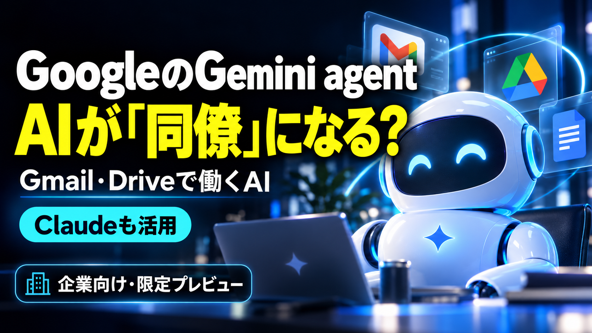
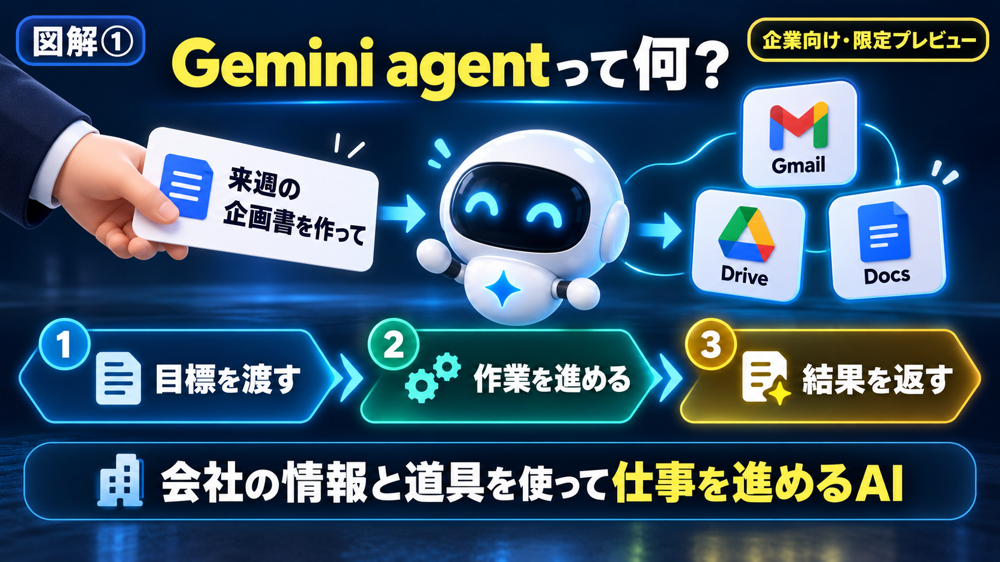
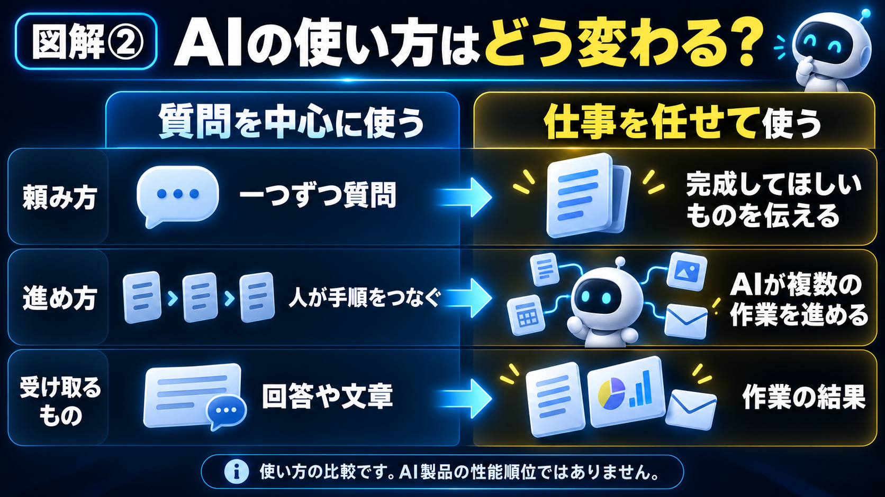
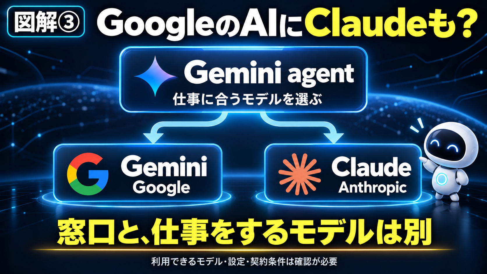
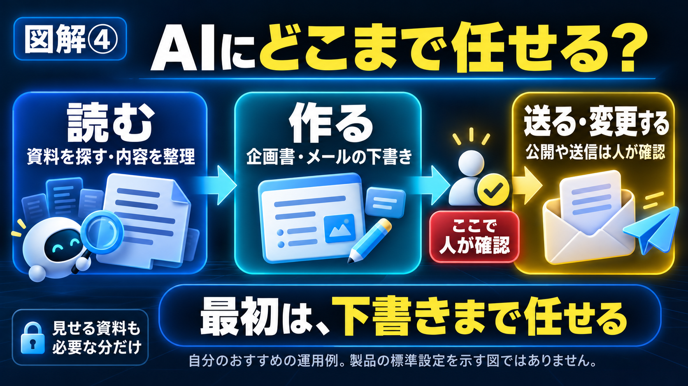

# 【海外AI解説】GoogleのGemini agentって何？Gmail・Driveで働く「同僚AI」にClaudeも

「AIに聞けば、文章は返ってくる。でも、結局その後は自分でやっている」

GoogleのGemini agentの発表を見て、自分はまず、この普段の手間を思い出しました。AIを使っていて、こう感じることはありませんか。

調べてもらった内容をコピーする。資料を開く。必要なところを直す。別のアプリに貼り付ける。

一つひとつは楽になったはずなのに、作業をつなぐ役目は、まだ自分に残っています。

今回Googleが発表した「Gemini agent」は、その間の作業まで任せる方向へ進んだAIです。GmailやGoogleドライブなど、会社が普段使っている場所で、仕事の目標を受け取り、必要な作業を進める。Googleはそんな使い方を示しています。

しかも、GoogleのAIなのに、AnthropicのClaudeも使えるとのこと。

最初は「GeminiなのにClaude？」と思いました。調べてみると、単に新しいチャット画面が増えるという話ではなさそうです。

今回は、2026年10月8日のGoogle公式発表と、その後の報道をもとに整理します。自分でGemini agentを使って検証した記事ではないので、発表で分かることと、自分の期待は分けて書きます。

## 30秒で結論

- Gemini agentは、Googleが発表した企業向けの業務用AIエージェント。質問への回答だけでなく、複数の作業を進めることを目指しています。
- Gmail、Drive、Docsなどで、仕事の情報や流れを引き継ぎながら使う設計です。クラウドで動き、パソコンを閉じた後も作業を続けられると説明されています。
- 土台となるモデルには、GoogleのGeminiだけでなく、AnthropicのClaudeも利用できます。
- チームで使うAIには、専用のメールアドレス、カレンダー、Driveなどを持たせる仕組みも紹介されました。
- 一般提供はまだ。発表時点では一部の顧客向けの限定プレビューです。「今すぐ全員が使える」「全部無料」とは受け取らない方がよさそうです。

個人的に気になったのは、AIがどれだけ賢くなったかより、**毎回こちらが作業をつながなくてもよくなるのか**、というところです。

## そもそも「Gemini agent」って何？

エージェントという言葉だけで、少し身構えてしまいますよね。

ざっくり言うと、目標を伝えると、そのための作業を進めるAIです。

例えば、「この文章を要約して」なら、一つの依頼が終われば結果が返ってきます。

それに対して、Googleが示しているのは、「この仕事をここまで仕上げて」と頼む使い方です。必要な情報を探す。資料を読む。内容を整理する。文書を作る。仕事によってはコードを書いて動かす。こうした段取りをまとめて扱います。

GoogleはGemini agentを、仕事のための一つの共通窓口として説明しています。

調査用のAI、文章用のAI、データ用のAIを、人間が毎回行き来する。その手間を減らし、一つの窓口から仕事を進めたい、という方向です。

もちろん、何を渡しても完成する魔法の箱ではありません。使える資料や道具、権限、頼み方によってできることは変わります。

それでも、「質問への返事」より先の部分を扱うところに、今回の発表の面白さがあります。

【ここに図解①を挿入｜Gemini agentの全体像】

## 普通にAIへ質問するのと、何が変わる？

例えば、来週の会議に向けて企画書を作る場面を考えてみます。

AIに案を出してもらう。過去の資料は自分で探す。メールで来ていた条件も自分で確認する。最後に文書へまとめる。

今でもAIは役に立ちます。ただ、どの情報を使い、どの順番で作業するかは、人間が一つずつ橋渡しすることが多いと思います。

Gemini agentの発表では、そこまで含めて仕事を進める使い方が示されています。

「過去の資料と今回の条件を確認して、会議用の企画書を作って」

こんな目標を受け取り、接続を許された資料やアプリを使って、完成に向けて作業するイメージです。

ここで比べているのは、質問中心の使い方と、仕事を任せる使い方です。普通のChatGPTやClaudeに、こうした機能が一切ないという意味ではありません。

自分としては、AIが長い文章を書けることより、毎回の「次はこれをやって」をどれくらい減らせるのかが気になります。便利さを感じるのは、案外そういう地味な部分だったりします。

## パソコンを閉じても動く、というのが大きい

Googleが強調している特徴の一つが、クラウドで仕事を続ける仕組みです。

クラウドというのは、自分のパソコンの中だけでなく、外部のサーバー上で処理する形のこと。Googleは、数時間から数日かかる仕事でも、パソコンを閉じた後に作業を続けられると説明しています。

朝に頼んだ仕事を、移動中はスマホから確認する。必要があれば途中で条件を追加する。後で別の端末から続きを見る。

そのたびに最初から事情を説明し直す手間を減らしたい、という設計です。

ただ、「ずっと動ける」ことと、「絶対に失敗しない」ことは別です。処理が止まる場合も、確認が必要になる場合もあるでしょう。

自分なら、完成したかどうかだけでなく、どこまで進んでいて、何で止まっているのかを見られるかも気になります。放っておける時間が増えるほど、途中の状態が分かることも大事になりそうです。

【ここに図解②を挿入｜質問するAIと仕事を任せるAI】

## 毎回「前の話」を説明しなくてよくなる？

AIを使うとき、意外と面倒なのが、前提を渡す作業です。

どんな文章が好きか。誰に向けた資料なのか。前回は何を直したのか。毎回これを説明していたら、便利なはずのAIに、自分が研修をしているような気分になります。

Googleは今回、作業中の情報、蓄えた知識、仕事の手順、過去に行ったことという、4種類の記憶を説明しています。

専門的な名前を全部覚える必要はありません。「今やっていること」と「これまで一緒に進めた仕事」を、次の作業にも生かす方向だと考えると分かりやすいです。

例えば、会社の資料には決まった書式があります。毎回ゼロから「見出しはこう、表はこう」と教えるより、その流れを引き継いでくれる方が助かります。

ただ、覚えてくれるなら、間違った情報や古い方針をどう直すかも見ておきたいところです。以前の条件を覚えていることが、いつも正解とは限りません。

記憶が長く続くほど、「今回は前と違うよ」と伝えたときに、きちんと修正できるか。自分はそこも使い心地を左右すると思っています。

## AIにもメールアドレスやDriveを持たせる

今回、ちょっと驚いたのがここです。

Googleは、チームの一員として働く「coworker agent」という仕組みを紹介しています。coworkerは同僚という意味です。

このAIは専用のWorkspaceアカウントを持ち、メールアドレス、カレンダー、Drive、会社の名簿上の存在を持てると説明されています。

人がチャットで呼びかけたり、文書のコメントで依頼したりする。AIが作業を進め、結果を同じ場所へ返す。自分の名前ではなく、AI自身の名前で動く設計です。

例えばGoogleは、イベント担当のAIに準備資料の下書きを頼み、チャットへ返してもらう使い方を示しています。

これは「人間と同じ責任を負う社員ができた」という話ではありません。ただ、誰が作った資料なのか、どのAIに何を頼んだのかを区別しやすくする点は、実務では大きそうです。

なお、会社の中身を何でも自由に読めるという説明ではありません。共有された情報や、参加を許された場所に応じてアクセスする仕組みです。

## Geminiなのに、なぜClaudeも使えるの？

名前を見ると、全部Geminiのモデルで動くように感じます。

でもGoogleは、仕事を受け付けるエージェントと、その中で処理をするモデルを分けて説明しています。

窓口はGemini agent。その仕事に合うモデルを選ぶときに、Geminiのモデル群だけでなく、AnthropicのClaudeも使える、ということです。

Googleは、作業に応じて適したモデルを使うことで、品質と費用のバランスを取る考え方を示しています。

例えば、短い情報整理と、複雑な判断を含む長い作業では、必要な能力が違います。全部を一番大きなモデルで処理するのが、いつも得とは限らないわけです。

自分はここに、「どのAIが一番か」という比べ方から、仕事ごとに組み合わせる使い方への変化を感じました。

ただし、Claudeを別で契約していれば自動的につながる、という意味ではありません。利用できるモデルや設定、データの扱いは、実際の提供条件を確認する必要があります。

【ここに図解③を挿入｜GeminiとClaudeの役割】

## 自分なら、まず何を任せたい？

ここからは、自分の考えです。実際にこの製品で動かした例ではありません。

まず任せたいのは、散らばった情報を一つの下書きにする仕事です。

会議のメモはDocs。追加の条件はメール。参考資料はDrive。作業を始める前に、それらを探して読むだけで時間が過ぎてしまう。

例えば、必要な資料を指定して「決まったこと、まだ決まっていないこと、次に確認することを整理して」と頼む。そこで作ってもらった内容を、人間が読んで仕上げる。

このくらいの使い方でも、毎日の負担は変わりそうです。

コンテンツ制作なら、資料を集める、複数の発表を照合する、構成を考える、下書きにする、といった部分でしょうか。ただ、参考資料に書かれていないことを、AIがもっともらしく足してしまわないかは見たいです。

「良い文章だから使う」で終わらず、その文章の根拠をたどれること。自分は、記事を書く仕事ほどそこが大事だと思っています。

## 「任せる」と「全部好きにしていい」は違う

読むだけの作業と、送信や変更をする作業では、間違えたときの影響が違います。

企画書の下書きに間違いがあれば、直せます。でも、間違った内容を顧客へ送ってしまったら、文書だけ直して終わりとはいきません。

Googleは、AIの本人確認、アクセス権限、操作の記録、実行環境の分離、外部通信の管理といった仕組みを紹介しています。

それでも、自分なら最初は下書きまで任せる形にします。資料を読む、案を作る、確認する。その後、送信や公開をどこまで任せるかを少しずつ決める。

これは製品の標準設定を説明しているのではなく、自分がおすすめしたい始め方です。

また、AIが読める資料も、必要な分だけ渡したいです。「会社の情報を全部入れたら便利」という話と、「今の仕事に必要な資料を渡す」は同じではありません。

どこまで見せるか。何を変えてよいか。どこで人が確認するか。

この三つを先に決めておくと、任せるときの不安も整理しやすいと思います。

【ここに図解④を挿入｜AIに任せる範囲と人の確認】

## 誰でも使える？料金はどうなる？

2026年10月11日時点で確認した発表・報道では、一般提供はまだです。VentureBeatは、Googleの担当者に確認した内容として、一部の顧客向けに限定プレビューが始まったと報じています。

「自分のGmailに、もう同じ機能があるはず」と探しても、見つからない可能性があります。今回紹介された企業向けの仕組みと、普段使っている個人向けGeminiは分けて考えた方がよさそうです。

料金について同誌は、対象となるGemini Enterpriseや一部の既存Workspace契約で、エージェントを追加料金なしで提供する方針を伝えています。

ただ、ここから「何人分のAIを、どれだけ動かしても無料」とは言えません。常時動く同僚AIの詳しい料金条件などは、今後説明するとされています。

Google公式も、モデルの使用量や実行環境の費用を追跡し、プロジェクトの予算上限に達したらAIを止める仕組みを紹介しています。

使える契約、追加費用、使用量の扱い、日本での提供条件。このあたりがそろってから、自分に合うか判断したいです。

## 私の正直な感想

今回、自分が一番引っかかったのは、「同僚AI」という名前の未来感より、毎回説明する手間が減るかもしれない、というところでした。

自分も今、AIを使って記事の調査、執筆、保存、公開までの流れを整えています。

そこで欲しかったのは、単に文章を長く書いてくれるAIではありません。前に決めた記事の形を覚えて、同じ話題を避けて、必要なところまで進めてくれることでした。

実際、文章ができた後で「過去の記事と流れを合わせたい」「図解も入れたい」となると、それまで伝えたことを、もう一度整理する必要がありました。

だから、仕事の背景や好みを引き継ぐというGoogleの説明は、自分にとってかなり身近でした。毎回、新しく仕事を頼む感覚が少し薄くなるなら、それだけでも使いたくなります。

一方で、こちらの希望を覚えたまま、違う方向へどんどん進まれても困ります。任せたいのは作業であって、自分が何を大事にするかまで勝手に決めてほしいわけではないからです。

自分に合うAIは、何でも先回りするAIより、決めたことを守り、分からないところでは止まってくれるAIかもしれません。

Gemini agentが実際にどこまでそれをできるのかは、まだ触って確かめられていません。ただ、今後見るときのポイントは、少しはっきりしました。

## よくある質問

### Q1. 普通のGmailを使っていれば、今すぐ使えますか？

今回紹介された機能は、企業向けの限定プレビューです。個人のGmail利用者全員へ、同じ仕組みが提供されたという発表ではありません。利用資格や一般提供の案内を確認する必要があります。

### Q2. AIが会社のメールやファイルを全部読めるのですか？

Googleは、共有や権限に応じて情報へアクセスする仕組みを説明しています。何でも無条件に読めるという意味ではありません。実際に使うときは、管理者の設定と、AIに共有した情報を確認したいです。

### Q3. Gemini agentとClaudeは、どちらが優秀なのですか？

今回の話では、仕事の窓口となるエージェントと、処理を担うモデルを比べてしまうことになります。Gemini agentがClaudeのモデルを利用する場合もあるため、単純な勝ち負けの比較ではありません。

### Q4. パソコンを閉じていても、本当に作業するのですか？

Googleは、クラウドで動き、パソコンを閉じた後も作業を続ける設計だと説明しています。ただし、権限、予算、確認待ちなどによって作業が止まる場合も考える必要があります。

### Q5. 自分も「AI社員」を作るべきですか？

今すぐ大きな仕組みを作る必要はないと思います。まず、繰り返している仕事の中で、情報整理や下書きなど、任せたい部分を一つ選ぶ。それが分かるだけでも、今使っているAIへの頼み方は変えられます。

## まとめ

GoogleのGemini agentは、普段の仕事の場所で、目標を受け取り、複数の作業を進める方向へ進んだAIです。

GmailやDriveとのつながり。仕事の情報を引き継ぐ記憶。パソコンを閉じても続く作業。Geminiだけに限らないモデル選び。チームの一員としての専用アカウント。

発表には、気になることがいくつもありました。

ただ、最終的に自分が見たいのは、毎日の仕事のどこが楽になるのかです。資料を探す時間が減るのか。説明し直す回数が減るのか。直したことを次に生かしてくれるのか。

「新しいAIが出たから使わなきゃ」と急ぐより、まずは、自分が何を任せたいのかを考えておく。

今回のニュースを読んで、自分はそんなところから始めたいと思いました。

## この記事について

この記事は、Googleの公式発表と複数の報道を確認し、AIを日常で使っている一般ユーザーの目線で整理しました。Gemini agentの実機レビューではありません。提供条件や料金は更新される可能性があるため、利用前には最新の公式案内をご確認ください。

確認日：2026年10月11日。

## 参考リンク（Sources）

- [Google公式：Gemini at Work 2026でのGemini agent発表（2026年10月8日）](https://cloud.google.com/blog/products/ai-machine-learning/welcome-to-gemini-at-work-2026/)
- [VentureBeat：継続して働くGemini agentと専用アカウント、提供・料金の説明（2026年10月8日）](https://venturebeat.com/orchestration/google-cloud-unveils-persistent-gemini-agents-for-long-running-tasks-and-they-get-their-own-gmail-calendar-and-drive-storage)
- [TechRadar：Googleの業務用Gemini agentと限定プレビューの報道（2026年10月9日）](https://www.techradar.com/pro/google-reveals-gemini-agents-a-single-universal-agent-for-work-which-will-even-get-their-own-gmail-account)
- [過去の記事：OpenAIの「Dots」を解説](https://note.com/quiet_spirea2390/n/n6295051dd97f)
- [過去の記事：Claude CodeとCoworkの違い](https://note.com/quiet_spirea2390/n/nf7b4b947419d)

\#AI #Google #Gemini #Geminiagent #Claude #Anthropic #AIエージェント #生成AI #GoogleWorkspace #Gmail #仕事効率化 #AIニュース
